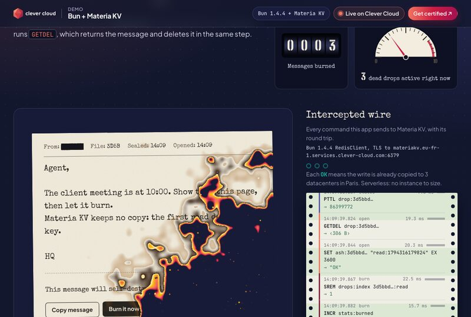
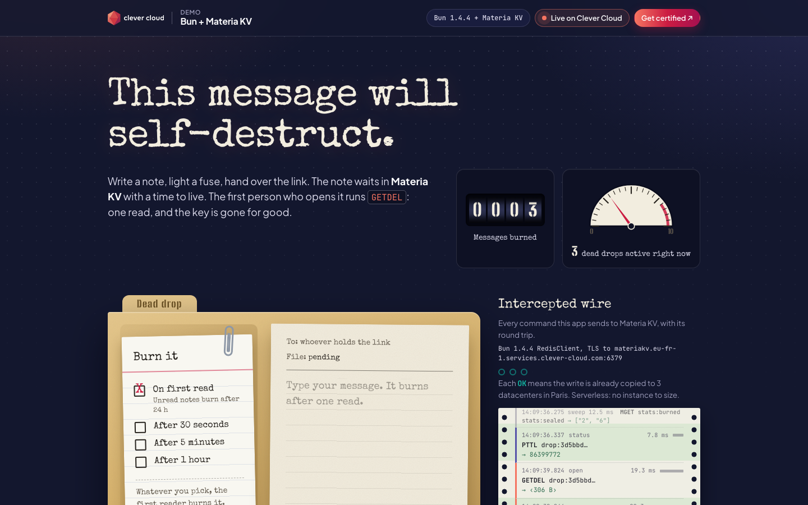
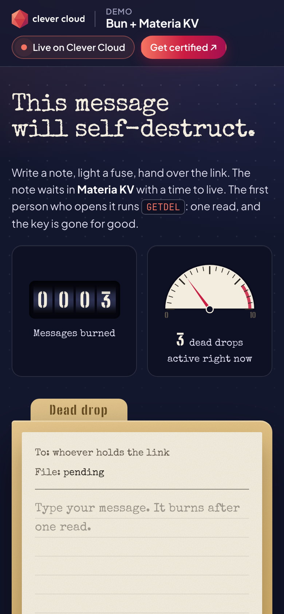

# This message will self-destruct — Bun + Materia KV on Clever Cloud

> A spy dead drop for one-time messages. Write a note, light a fuse, hand over the link. The note waits in **Materia KV** with a TTL; the first person who opens it runs `GETDEL`, reads it once on a typewriter, and watches it burn. A second visit finds only ash. A line-printer "intercepted wire" prints every command the app sends to Materia KV, with its real round trip.



| Leave a message | On a phone |
|---|---|
|  |  |

**Run it yourself.** The hosted demo was taken down after the presales review (November 2026). The steps in [Deploy on Clever Cloud](#deploy-on-clever-cloud) recreate it from scratch in about 5 minutes.

**Get certified.** This demo runs on Clever Cloud. To deploy your own apps the same way, get certified at the [Clever Cloud Academy](https://academy.clever.cloud/).

---

## What Materia KV does here

Materia KV is Clever Cloud's serverless key-value database: no instance to size, every write synchronously replicated across 3 datacenters in Paris, and it speaks the Redis protocol. This app talks to it with **Bun's built-in `RedisClient`** over TLS: no driver, no dependency.

| Moment | Commands | Why |
|---|---|---|
| Seal a message | `SET drop:<hash> <ciphertext> EX <ttl> NX`, `SADD drops:index`, `INCR stats:sealed` | The TTL is the fuse: 30 s, 5 min, 1 h, or 24 h for "on first read" |
| Read it once | `GETDEL drop:<hash>` | Returns the value and deletes the key atomically: two readers racing on one link cannot both get it |
| Leave ash | `SET ash:<hash> "read:<time>" EX 3600` | The sender's page flips to "Burned, opened at 14:02:31" |
| Count the burn | `SREM drops:index …` then `INCR stats:burned` if it really removed it | Counted exactly once, even when a reader and a sweep race |
| Countdown | `PTTL drop:<hash>` | Live TTL on the sender's receipt and on every tag of the board |
| Sweep (every 10 s) | `SMEMBERS drops:index`, `PTTL` × N pipelined, `MGET` | Materia KV expires keys lazily, on access: reading each key retires the ones whose fuse ran out |

Measured from the app on Clever Cloud: `PING` about 2 ms, reads about 10 ms, replicated writes about 15 to 25 ms. `MULTI` is not supported by Materia KV, so the design relies on single atomic commands (`GETDEL`, `SET … NX`, `SREM`'s return value).

## How a message stays secret

- **The link is the key.** It carries a random 128-bit id in the URL fragment (`/r#<id>`). Browsers never send the fragment to the server, so the id stays out of access logs, and chat apps that unfurl links cannot burn the message by previewing it.
- **Materia KV only sees hashes and ciphertext.** The key is `drop:` + SHA-256 of the id; the value is AES-256-GCM sealed with a key derived from the id. Nobody reading the database or the wire log can rebuild a link or read a message.
- The id travels in `POST` bodies only. Messages are limited to 2048 bytes, rendered with `textContent` (never parsed as HTML), behind a strict CSP with no inline script. Sealing is rate-limited per address, and the drop box caps at 500 waiting messages.

## Deploy on Clever Cloud

You need [clever-tools](https://www.clever.cloud/developers/doc/cli/) (`clever login` done) and the ID of the organisation that will own the resources (`orga_…`, shown in the Console). Run the commands from the repo root: `clever create` links the folder to the new app.

```bash
# 1. The app and its size
clever create --type node demo-bun-materia-kv --org <org_id> --region par
clever scale --min-flavor nano --max-flavor XS --min-instances 1 --max-instances 2
clever scale --build-flavor M

# 2. Materia KV (plan base, the only one; the provider offers no encryption option), linked to the app
clever addon create kv demo-bun-materia-kv-kv --plan base --region par --org <org_id>
clever service link-addon demo-bun-materia-kv-kv

# 3. Variables
clever env set NODE_ENV production
clever env set CC_HEALTH_CHECK_PATH /health

# 4. Deploy
clever deploy
clever open
```

`bun.lock` tells the Node.js & Bun runtime to build and run with Bun (the latest Bun available on Clever Cloud; 1.4.4 at the time of writing). `package.json` starts `bun src/server.ts`; there is no build step, no secret to generate and no setup script (the decoy dossiers are seeded at startup). `GET /health/deep` sends a `PING` to Materia KV.

## Variables

| Variable | Set by | Role |
|---|---|---|
| `REDIS_URL` | Materia KV add-on, when linked | `rediss://` connection string read by `RedisClient` (TLS, port 6379). The add-on also injects `KV_HOST`, `KV_PORT`, `KV_TOKEN` and their `REDIS_*` aliases; the code only needs `REDIS_URL` |
| `PORT` | Clever Cloud | 8080; the server binds `0.0.0.0` |
| `NODE_ENV` | you | `production`, as the runtime doc asks |
| `CC_HEALTH_CHECK_PATH` | you | `/health`: answers 200 without touching the add-on. `/health/deep` sends a `PING` to Materia KV |

The "Running on Clever Cloud" panel shows only `CC_APP_NAME`, `APP_ID`, `INSTANCE_NUMBER`, `INSTANCE_TYPE`, `CC_PRETTY_INSTANCE_NAME`, `CC_COMMIT_ID` (short) and `CC_DEPLOYMENT_ID`. The wire panel shows the public Materia KV host and port, never the token.

## Run it locally

```bash
brew install redis                       # any Redis-compatible server works locally
redis-server --port 8643 --save '' &
REDIS_URL=redis://127.0.0.1:8643 PORT=8642 bun run dev
bun test                                 # unit + end-to-end tests (starts its own redis-server)
```

At startup the app seeds three decoy dossiers from "HQ" (`SET … NX`, idempotent), so the board is never empty.

## Routes

`GET /` (leave a message), `GET /r#<id>` (read it once), `POST /api/drops`, `POST /api/drops/open`, `POST /api/drops/status`, `GET /api/pulse` (counters, board, wire log), `GET /api/platform`, `GET /health`, `GET /health/deep`.

## Project structure

```
src/server.ts   Bun.serve routes, security headers, rate limit, seed at startup
src/drops.ts    every Materia KV operation: seal, open, status, sweep, decoys
src/kv.ts       Bun RedisClient + the traced kv() wrapper that feeds the wire log
src/crypto.ts   128-bit ids, hashed keys, AES-256-GCM sealing
public/         one page, two scenes; css/cc-brand.css is the Clever Brand Kit (copied as-is)
public/js/      app.js (scenes), wire.js (live panels), burn.js (the fire)
test/           bun test: crypto unit tests, HTTP end-to-end against a throwaway redis-server
```

## License

MIT, see [LICENSE](LICENSE).
